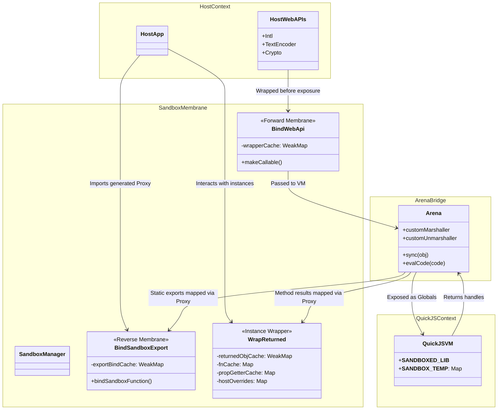
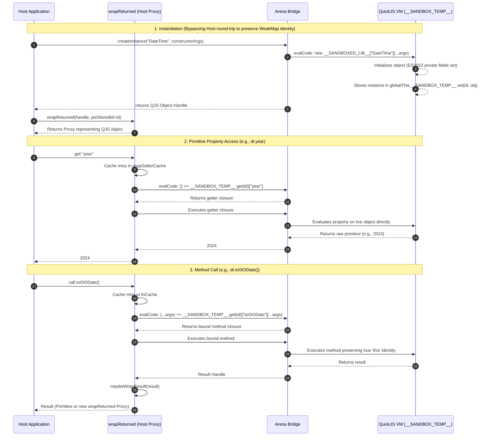
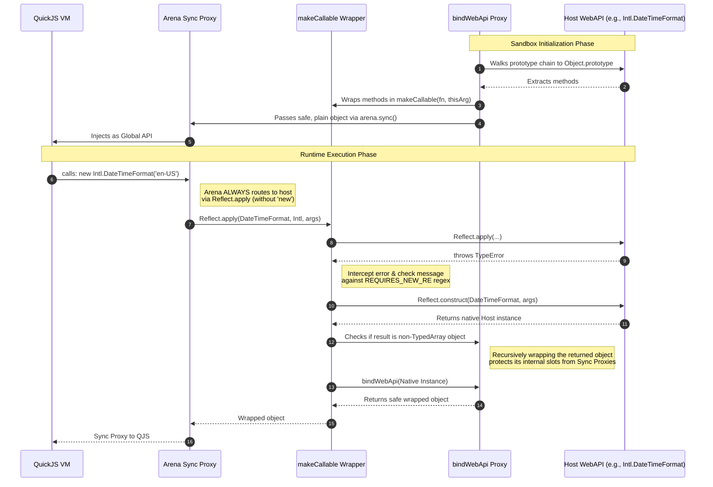

# Sandbox Membrane Architecture

This document visualizes the bidirectional membrane pattern built around the `quickjs-emscripten-sync` Arena. These diagrams explain how objects, functions, and constructors are safely mapped, cached, and executed across the Host and QuickJS boundary.

## 1. Membrane Architecture & Caching Strategy

This component diagram illustrates the static architecture of the boundary. It shows how the Host and QuickJS environments are isolated, and how the specialized caching layers (`WeakMap` and `Map`) ensure object references are stable and infinite recursion is prevented.

## 2. Reverse Membrane: Host Consuming QuickJS Objects

This sequence diagram details how a Host application creates a sandboxed class instance and accesses its properties/methods. It specifically highlights the `createInstance` bypass and primitive property evaluation, which ensure that ES2022 private fields and prototype getters (like Luxon's `DateTime.year`) evaluate correctly inside the VM.

## 3. Forward Membrane: QuickJS Consuming Host WebAPIs

This diagram explains how complex Host WebAPIs are safely exposed to QuickJS. It visualizes the `bindWebApi` wrapper protecting native internal slots, and the `makeCallable` dynamic resolution of the `TypeError` caused when QuickJS invokes a Host constructor via the Arena's strict `Reflect.apply` routing.

